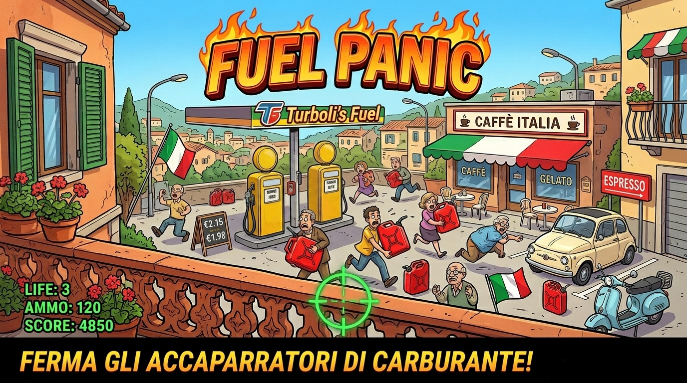

# ⛽ Fuel Panic



A satirical 2D arcade shooter built with **Phaser 3**, inspired by fuel shortages, panic buying, and people stockpiling petrol. 
Stand on your balcony overlooking a petrol station and stop the greedy hoarders before they drain every last drop!

> **Play now:** [https://haxifi.github.io/FuelPanicGame](https://haxifi.github.io/FuelPanicGame)

---

## 🎮 Gameplay

You watch a busy fuel station from a fixed balcony position. 
Vehicles pull up to the pumps and customers get out.
Your job is to identify the **hoarders** — and stop them before they flee with stolen fuel.

### Customer Types

| Customer type | Appearance | Vehicle | Behaviour | Action |
|---|---|---|---|---|
| **Normal** 🟢 | Green shirt | Small hatchback, SUV | Fills only vehicle tank, then leaves peacefully | **Do NOT shoot** — you lose 150 points |
| **Hoarder** 🔴 | Red shirt, angry face | Van, SUV | Fills vehicle tank *then* fills jerry cans | **Shoot them** before they finish! +100 pts (+ combo bonus) |
| **ApeCar** 🛺 / 🔴 | Red shirt & Piaggio Ape | Ape Car (three-wheeler) | Rapidly steals fuel (`STEALING_CANS`, 1.8x speed) | **Requires 2 hits!** 1st hit staggers ("NON MOLLA!"), 2nd hit stops them |

### Rules & Mechanics

- **Aim & Shoot:** Aim with mouse (desktop) or tap on the customer (mobile). Tap or click to fire.
- **Ammunition & Reload:** 6-round magazine. Reload by pressing `R` or tapping the on-screen `🔄 R` button.
- **Visual Warnings:** Hoarders flash a ⚠️ icon; ApeCars flash a faster 🚨 icon once illegal fueling begins.
- **Progress Bar Indicator:**
  - 🟢 **Green:** Standard vehicle fueling (Normal, Hoarder, ApeCar).
  - 🟠 **Orange:** Hoarder filling auxiliary jerry cans (`FUELING_CANS`).
  - 🔴 **Red:** ApeCar high-speed fuel theft (`STEALING_CANS`).
- **Combo Multiplier:** Catch hoarders in quick succession within 3 seconds to trigger combo streaks (`COMBO x2!`, `COMBO x3!`, awarding an extra `combo * 50` points per kill).
- **Lose Conditions:**
  - ⏱️ **Time Up:** The 90-second round timer expires.
  - ⛽ **Fuel Out:** 5 hoarders escape with stolen fuel (the "Carburante rubato / Fuel stolen" gauge reaches maximum).

### Controls

| Input | Desktop | Mobile / Touch |
|---|---|---|
| Aim | Mouse movement | Touch position |
| Shoot | Left click | Tap |
| Reload | `R` key | `🔄 R` button (on-screen HUD) |
| Start / Restart | `Space` / Click button | Tap button |
| Main Menu | Click link | Tap link |

---

## 📈 Difficulty & Progression

The game features an escalating difficulty curve managed in [`GameScene.js`](src/scenes/GameScene.js):

- **Difficulty Timer:** Every 10 seconds, the difficulty level increases by `+0.5`.
- **Spawn Interval:** Customer arrival intervals accelerate dynamically:
  $$\text{delay} = \max(800\text{ ms},\, 2500 - \text{difficulty} \times 200\text{ ms})$$
- **Hoarder Spawn Ratio:** The probability of a customer being a hoarder increases over time:
  $$\text{hoarderChance} = 0.25 + \text{difficulty} \times 0.06$$
- **Jerry Cans Carried:** Hoarders carry more jerry cans as difficulty climbs:
  $$\text{maxCans} = \max(1,\, \lfloor 1 + \text{difficulty} \times 0.5 \rfloor)$$
- **Fueling Speed:** Baseline fueling rate speeds up with difficulty:
  $$\text{fuelSpeed} = 0.3 + \text{difficulty} \times 0.08$$
- **ApeCar Aggression:** ApeCars steal fuel at **1.8x** the baseline hoarder speed (`stealingSpeedMultiplier = 1.8`) and leave the station faster once done.

---

## 🌍 Internationalization (i18n)

The game includes a zero-dependency, lightweight internationalization engine located in [`src/i18n/`](src/i18n/):

- **Supported Languages:**
  - 🇮🇹 **Italian (`it`)** — default locale.
  - 🇬🇧 **English (`en`)** — full localization for all UI, HUD, dialogs, comments, and overlays.
- **Auto-Detection:** Detects browser language on launch via `navigator.language` (falls back to `it`).
- **Global Helper:** `t(key, params)` helper resolves dot-separated keys and supports variable interpolation (e.g., `t('game.difficulty_label', { level: 2 })`).
- **DOM Integration:** Elements in `index.html` use `data-i18n` (for text content) and `data-i18n-html` (for HTML formatting) to automatically update when the language changes.
- **Runtime Switching:** Supports asynchronous locale switches via `I18n.setLocale('en')` or `I18n.setLocale('it')`.

---

## 🛠 Tech Stack

| Component | Technology | Description |
|---|---|---|
| **Game Engine** | [Phaser 3.60](https://phaser.io/) | Vendored in `lib/phaser.min.js` (no CDN or external network needed) |
| **Language** | Vanilla JavaScript (ES6+) | Native ES6 classes and modules, no transpiler required |
| **Localization** | Custom i18n Engine | JSON translation catalogs (`it.json`, `en.json`) with auto-detection |
| **Graphics** | Procedural Canvas Rendering | All textures drawn dynamically at boot via `GraphicsGenerator` |
| **Audio** | Web Audio API | Procedural sound effect synthesis via `SoundGenerator` |
| **Responsive Design** | Phaser Resize + CSS3 | `Phaser.Scale.RESIZE` with dynamic proportional scaling (`1024x600` virtual reference) |
| **Mobile Overlay** | Vanilla JS + CSS Animations | Orientation controller (`events.js`) and animated rotation prompt |
| **Build Tools** | Zero Build / Zero Dependencies | Runs directly in any static HTTP server |

---

## 🚀 Getting Started

### Prerequisites

- A modern web browser (Chrome, Firefox, Safari, Edge).
- A local web server (to permit local `fetch()` for i18n JSON files).

### Install & Run

```bash
# Clone the repository
git clone git@github.com:haxifi/FuelPanicGame.git
cd FuelPanicGame

# Option A — npm (http-server)
npm start
# or: npm run dev

# Option B — Python 3
python3 -m http.server 8080

# Option C — Node.js npx
npx http-server -p 8080 -c-1
```

Open **http://localhost:8080** in your browser to play.

---

## 📁 Project Structure

```
FuelPanicGame/
├── index.html                      ← HTML entry point, viewport config & portrait overlay
├── favicon.ico                     ← Multi-resolution icon (16x16, 32x32, 48x48)
├── favicon.svg                     ← Scalable vector favicon
├── apple-touch-icon.png            ← iOS / mobile web clip icon
├── package.json                    ← npm dev & start scripts
├── package-lock.json               ← Dependency lockfile
├── phasereditor2d.config.json      ← Phaser Editor project configuration
├── cover.jpeg                      ← Game cover banner
├── lib/
│   └── phaser.min.js               ← Phaser 3.60 library (vendored, zero external CDN)
└── src/
    ├── main.js                     ← Game configuration, responsive setup & boot sequence
    ├── events.js                   ← Mobile device detection & orientation overlay manager
    ├── styles/
    │   └── main.css                ← Game styling, mobile viewports & portrait animation
    ├── i18n/
    │   ├── i18n.js                 ← Custom i18n engine, language detection & DOM updater
    │   ├── it.json                 ← Italian translation catalog (default)
    │   └── en.json                 ← English translation catalog
    ├── utils/
    │   ├── GraphicsGenerator.js    ← Procedural vector/sprite texture generation
    │   └── SoundGenerator.js       ← Procedural Web Audio sound synthesis
    ├── objects/
    │   ├── Bullet.js               ← Bullet impact hole effect & fading animation
    │   ├── Customer.js             ← Customer state machine (Normal, Hoarder, ApeCar)
    │   ├── FuelPump.js             ← Station pump object & occupancy tracker
    │   └── Vehicle.js              ← Vehicle sprite wrapper (Small, SUV, Van, Ape)
    └── scenes/
        ├── BootScene.js            ← Generates procedural assets & boots i18n
        ├── MenuScene.js            ← Title screen, animated pump background & instructions
        ├── GameScene.js            ← Core loop, pump layout, spawning, shooting & HUD
        └── GameOverScene.js        ← Final score, performance ratings, stats & restart
```

---

## 🔧 Customisation Guide

### 1. Add a new customer type or state

Customer behaviour is managed by the state machine in [`Customer.js`](src/objects/Customer.js). Current state flows:

```
Normal:  ARRIVING → FUELING_VEHICLE ──────────────────────────→ LEAVING → GONE
Hoarder: ARRIVING → FUELING_VEHICLE → FUELING_CANS ───────────→ LEAVING → GONE
ApeCar:  ARRIVING → FUELING_VEHICLE → STEALING_CANS (1.8x spd) → LEAVING → GONE
                                           │
                                     (on 2nd hit)
                                           ↓
                                          HIT → GONE
```

To add a new customer type (e.g., a "Tanker Truck Thief"):

1. Add a new state to `Customer.STATES`:
   ```js
   static STATES = {
       // ...existing states
       FUELING_TANKER: 'fueling_tanker'
   };
   ```
2. Branch in `Customer.update()` during the `FUELING_VEHICLE` phase to transition to `FUELING_TANKER`.
3. Add the visual texture in [`GraphicsGenerator.js`](src/utils/GraphicsGenerator.js).
4. Spawn it inside `GameScene.spawnCustomer()`.

### 2. Add a new vehicle type

1. Draw the vehicle in `GraphicsGenerator.createVehicles()` using the Phaser `Graphics` API:
   ```js
   const g = scene.make.graphics({ x: 0, y: 0, add: false });
   g.fillStyle(0x336699, 1);
   g.fillRoundedRect(10, 15, 80, 35, 4);
   g.generateTexture('carPickup', 100, 60);
   g.destroy();
   ```
2. Register the texture in the `textureMap` inside [`Vehicle.js`](src/objects/Vehicle.js):
   ```js
   const textureMap = {
       small: 'carSmall',
       suv: 'carSUV',
       van: 'carVan',
       ape: 'apeCar',
       pickup: 'carPickup' // ← new
   };
   ```
3. Add the type name (`'pickup'`) to the vehicle selection arrays in `Customer.js`.

### 3. Add a new language (i18n)

1. Create a new translation file, for example `src/i18n/es.json`, copying the structure of `en.json`.
2. Register the locale code in [`src/i18n/i18n.js`](src/i18n/i18n.js):
   ```js
   const _supportedLocales = ['it', 'en', 'es'];
   ```
3. The engine will automatically detect and load Spanish when running on a Spanish browser locale, or you can switch manually via:
   ```js
   await I18n.setLocale('es');
   ```

### 4. Add a new procedural sound effect

Sounds are synthesised in [`SoundGenerator.js`](src/utils/SoundGenerator.js) using the Web Audio API without audio files:

```js
static createExplosionSound(scene) {
    const ctx = scene.sound.context;
    if (!ctx) return;
    const sampleRate = ctx.sampleRate;
    const length = sampleRate * 0.4;
    const buffer = ctx.createBuffer(1, length, sampleRate);
    const data = buffer.getChannelData(0);
    for (let i = 0; i < length; i++) {
        const t = i / sampleRate;
        data[i] = (Math.random() * 2 - 1) * Math.max(0, 1 - t / 0.4) * 0.4;
    }
    this.addBufferAsSound(scene, 'sfx_explosion', buffer);
}
```

Call it from `SoundGenerator.generate()` and trigger it in any scene using:
```js
this.playSound('sfx_explosion');
```

---

## 📱 Mobile & Responsive Architecture

The game is designed for seamless desktop and mobile play:

- **Adaptive Resolution (`Phaser.Scale.RESIZE`):**
  - Reference design: `DESIGN_WIDTH = 1024`, `DESIGN_HEIGHT = 600`.
  - Dynamic scaling factors `_sx = width / 1024` and `_sy = height / 600` scale pumps, railing, HUD text, buttons, and hitboxes proportionally across any screen size.
  - Active resize handler (`handleResize`) repositions all scene elements dynamically on window resize or orientation change.
- **Orientation Overlay (Phones):**
  - Managed by [`events.js`](src/events.js) and [`main.css`](src/styles/main.css).
  - Detects phones based on screen dimension heuristics (`shorter < 600px`).
  - Displays a localized overlay (`#rotate-overlay`) prompting phone users to rotate to landscape.
  - Automatically hidden on tablets (iPads, Android tablets) and desktop computers.
- **Touch Controls:**
  - Multi-touch enabled (`activePointers: 2`).
  - Dedicated on-screen `🔄 R` reload button for mobile devices.
  - Crosshair disabled on touch devices to avoid pointer conflicts.

---

## 📜 License

This project is released under the [MIT License](LICENSE).

---

## ✍️ Author

**Salvatore Turboli**  
📧 [salvatore.turboli@gmail.com](mailto:salvatore.turboli@gmail.com)  
🔗 [github.com/haxifi/FuelPanicGame](https://github.com/haxifi/FuelPanicGame)
